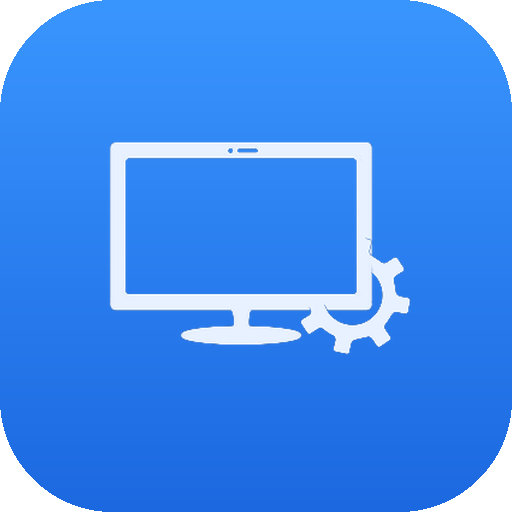
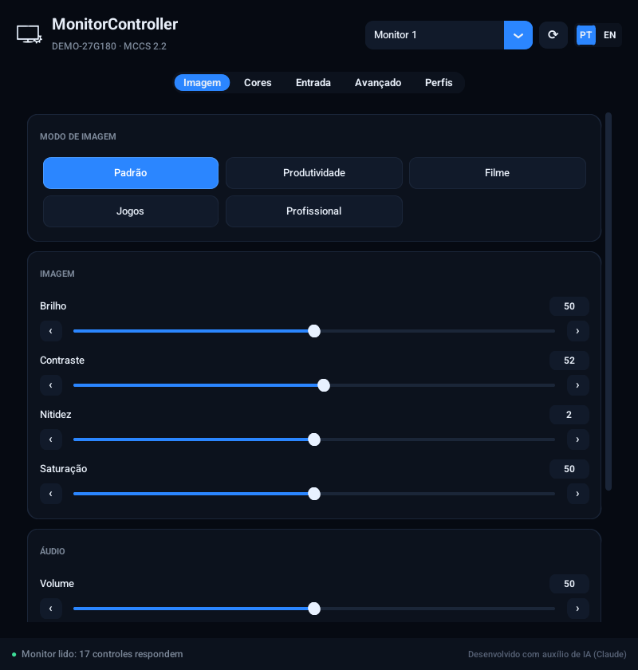
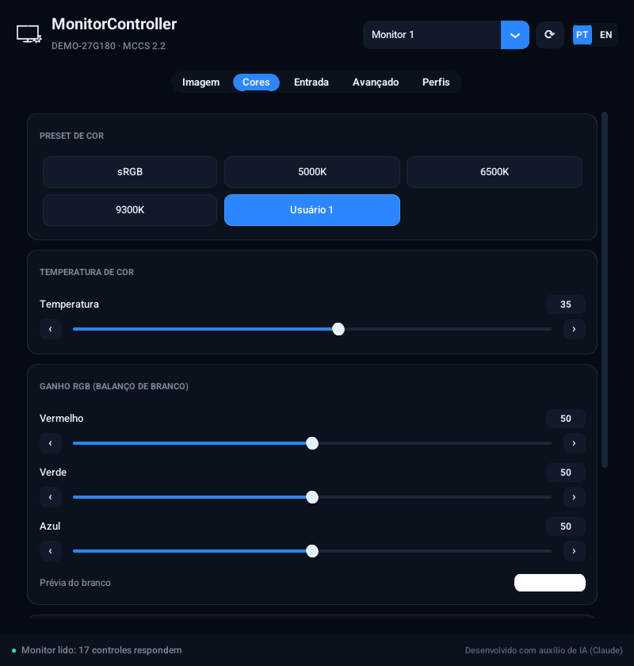
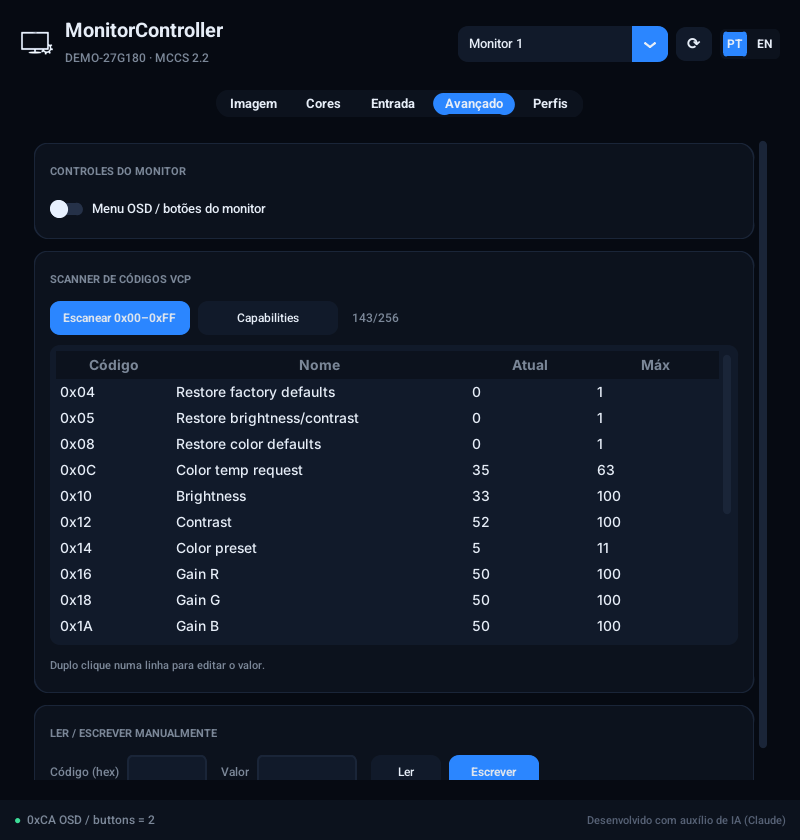
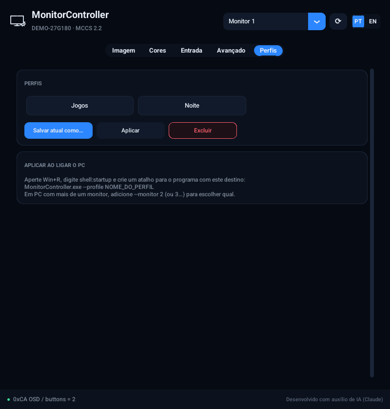

> ⚠️ **AVISO / NOTICE**
> 🇧🇷 **Este projeto foi desenvolvido com o auxílio de Inteligência Artificial (Claude, da Anthropic).** Pode conter erros: revise o código e use por sua conta e risco.
> 🇺🇸 **This project was developed with the help of Artificial Intelligence (Claude, by Anthropic).** It may contain mistakes: review the code and use it at your own risk.

<p align="center">
  
</p>

<h1 align="center">MonitorController</h1>

<p align="center">
  <b>Controle o seu monitor pelo Windows, sem usar os botões físicos.</b><br>
  <b>Control your monitor from Windows, no physical buttons needed.</b>
</p>

<p align="center">
  
  
</p>

[🇧🇷 Português](#-português) · [🇺🇸 English](#-english)

---

# 🇧🇷 Português

## O que é

O **MonitorController** é um programa para Windows que mexe nas configurações do monitor (brilho, contraste, cores, entrada de vídeo e mais) direto pelo computador, usando o protocolo **DDC/CI**, o mesmo canal que o monitor usa para conversar com o PC pelo cabo de vídeo.

Foi feito pensando em quem está com os **botões do monitor quebrados**, difíceis de alcançar ou simplesmente quer ajustar tudo com o mouse, salvar perfis (jogos, filmes, noite) e aplicá-los com um clique.

### Principais recursos

- **Interface escura e moderna**, em português e inglês (troca no canto superior direito).
- **Adapta-se a cada monitor**: o programa lê o que o seu monitor realmente suporta e mostra só essas opções. Um monitor simples de escritório mostra poucos controles, um monitor gamer mostra bem mais.
- **Imagem:** brilho, contraste, nitidez, saturação, matiz, modo de imagem, volume e mudo.
- **Cores:** preset de cor, temperatura, ganho RGB (balanço de branco, com prévia), nível de preto, saturação e matiz por cor.
- **Entrada:** troca de fonte (HDMI, DisplayPort, USB-C, VGA, DVI) com confirmação de segurança.
- **Vários monitores:** escolha qual monitor controlar no seletor do topo.
- **Perfis:** salve as configurações atuais e aplique depois, inclusive automaticamente ao ligar o PC.
- **Escurecer por software:** filtro escuro por cima da tela, para quando o monitor não aceita DDC/CI.
- **Aba Avançado:** controle do menu OSD/botões, resets, scanner de códigos VCP, leitura das *capabilities* e leitura/escrita manual de qualquer código.

## Capturas de tela

| Imagem | Cores |
|---|---|
|  |  |

| Avançado | Perfis |
|---|---|
|  |  |

> As capturas foram geradas no modo `--demo` (monitores simulados).

## Requisitos

- Windows 10 ou 11.
- Um monitor com **DDC/CI** (a grande maioria dos monitores externos tem). Em muitos modelos ele vem ligado de fábrica; em outros precisa ser ativado no menu do monitor (opção "DDC/CI").
- Python 3.9 ou mais novo, **só** se for rodar pelo código-fonte ou gerar o `.exe`.

## Como usar

### Opção 1: baixar o `.exe`

Baixe o `MonitorController.exe` na aba **Releases** do repositório e abra. Não precisa instalar nada.

### Opção 2: rodar pelo código-fonte

```bash
git clone https://github.com/kaoriinacio/MonitorController.git
cd MonitorController
pip install -r requirements.txt
python monitor_controller.py
```

### Opção 3: gerar o seu próprio `.exe`

Dê dois cliques em **`build_exe.bat`**. Ele instala as dependências e cria o arquivo em `dist\MonitorController.exe`.

### Usando o programa

1. **Abra o programa.** Ele lê o monitor sozinho e preenche as abas só com o que o seu monitor suporta. O nome do modelo e a versão do MCCS aparecem embaixo do título.
2. **Vários monitores?** Escolha qual controlar no seletor no topo. O botão **⟳** lê o monitor de novo.
3. **Aba Imagem:** arraste os sliders. Os botões **‹ ›** ajustam de 1 em 1. O modo de imagem aparece como botões (Padrão, Jogos, Filme...).
4. **Aba Cores:** escolha o preset de cor ou ajuste manualmente o ganho RGB. A caixinha "Prévia do branco" mostra a tonalidade resultante.
5. **Aba Entrada:** clique na entrada desejada. ⚠️ Se a entrada escolhida não tiver sinal, a tela fica preta e **não dá para voltar pelo programa**; por isso ele pede confirmação.
6. **Aba Perfis:**
   - ajuste o monitor do jeito que quer → **Salvar atual como…** → dê um nome;
   - selecione um perfil → **Aplicar** (ou **Excluir**).
7. **Aba Avançado:**
   - **Menu OSD / botões do monitor:** se o seu monitor reporta esse controle, é possível que os botões estejam bloqueados por software e este botão os libere;
   - **Escanear 0x00–0xFF:** lista tudo o que o monitor responde (com valor atual e máximo). Duplo clique numa linha edita o valor;
   - **Capabilities:** mostra o que o monitor declara suportar (útil para abrir uma issue);
   - **Ler / escrever manualmente:** código em hexadecimal (ex.: `10` para brilho) e valor.

### Aplicar um perfil ao ligar o PC (linha de comando)

```text
MonitorController.exe --profile NOME_DO_PERFIL
MonitorController.exe --profile NOME_DO_PERFIL --monitor 2
```

Para rodar a cada logon: aperte `Win + R`, digite `shell:startup` e coloque ali um atalho para o `.exe` com `--profile NOME_DO_PERFIL` no destino. Os perfis ficam em `%APPDATA%\MonitorController\profiles.json`.

Outras opções: `--lang pt` / `--lang en` (idioma) e `--demo` (monitores simulados, para testar a interface sem um monitor real).

## O monitor não responde. E agora?

- Ligue o **DDC/CI** no menu do próprio monitor, se existir a opção.
- Use cabo **HDMI/DisplayPort direto** na placa de vídeo. Adaptadores, docks, hubs USB-C e chaves KVM costumam bloquear o DDC/CI.
- Notebooks e telas internas geralmente **não** suportam DDC/CI. Alguns notebooks controlam o brilho por outro mecanismo.
- Alguns monitores só expõem uma parte dos controles. Isso é limitação do monitor.
- Abra a aba **Avançado → Escanear** para ver o que ele responde. Se nada responder, use o **Escurecer por software** (aba Imagem).
- Se faltar algum controle que o seu monitor tem no menu físico, abra uma *issue* com o resultado de **Capabilities** e do **Escanear**.

## Segurança

O programa envia comandos padrão DDC/CI ao monitor. No uso normal é seguro, mas lembre:

- **Troca de entrada** para uma fonte sem sinal deixa a tela preta até você trocar pelos botões do monitor.
- **Reset de fábrica** e **reset de cores** apagam as suas configurações do monitor.
- Na aba Avançado, escrever em códigos de fabricante (0xE0 em diante) ou de energia/entrada pede confirmação. Um valor inadequado pode causar comportamento estranho no monitor até ele ser desligado e religado.

## Como funciona

Usa a biblioteca [monitorcontrol](https://github.com/newAM/monitorcontrol) para falar DDC/CI com o monitor e o [CustomTkinter](https://github.com/TomSchimansky/CustomTkinter) para a interface. Ao abrir, o programa lê as *capabilities* do monitor (quando disponíveis) e testa os códigos VCP conhecidos para montar só os controles que respondem.

## Contribuindo

Relatos de compatibilidade (marca, modelo, o que funcionou e o que não) são muito bem-vindos via *issues*, assim como correções de nomes de modos/presets por fabricante.

## Licença

[MIT](LICENSE).

---

# 🇺🇸 English

## What it is

**MonitorController** is a Windows app that changes your monitor settings (brightness, contrast, colors, video input and more) straight from your PC using **DDC/CI**, the same channel the monitor uses to talk to the computer over the video cable.

It's made for people with **broken or hard-to-reach monitor buttons**, or anyone who'd rather tweak everything with a mouse, save profiles (gaming, movies, night) and apply them in one click.

### Features

- **Modern dark UI**, in Portuguese and English (switch at the top right).
- **Adapts to each monitor**: it reads what your monitor actually supports and only shows those controls. A basic office monitor shows a few; a gaming monitor shows many more.
- **Picture:** brightness, contrast, sharpness, saturation, hue, picture mode, volume and mute.
- **Color:** color preset, temperature, RGB gain (white balance, with a preview), black level, per-color saturation and hue.
- **Input:** switch source (HDMI, DisplayPort, USB-C, VGA, DVI) with a safety prompt.
- **Multiple monitors:** pick which one to control from the selector at the top.
- **Profiles:** save the current settings and apply them later, even automatically at startup.
- **Software dimmer:** a dark overlay on top of the screen for monitors that don't accept DDC/CI.
- **Advanced tab:** OSD/buttons control, resets, VCP code scanner, *capabilities* viewer and manual read/write of any code.

## Requirements

- Windows 10 or 11.
- A monitor with **DDC/CI** (most external monitors have it). Often it's on by default; on some models you must enable it in the monitor's own menu ("DDC/CI").
- Python 3.9+ **only** if you run from source or build the `.exe`.

## How to use

### Option 1: download the `.exe`

Grab `MonitorController.exe` from the repository's **Releases** tab and run it. No installation needed.

### Option 2: run from source

```bash
git clone https://github.com/kaoriinacio/MonitorController.git
cd MonitorController
pip install -r requirements.txt
python monitor_controller.py
```

### Option 3: build your own `.exe`

Double-click **`build_exe.bat`**. It installs the dependencies and creates `dist\MonitorController.exe`.

### Using the app

1. **Open the app.** It reads the monitor by itself and fills the tabs with only what your monitor supports. The model name and MCCS version show under the title.
2. **Several monitors?** Choose one in the selector at the top. The **⟳** button re-reads the monitor.
3. **Picture tab:** drag the sliders; the **‹ ›** buttons adjust by 1. Picture mode appears as buttons (Standard, Games, Movie...).
4. **Color tab:** choose a color preset or tune the RGB gain by hand. "White preview" shows the resulting tint.
5. **Input tab:** click the input you want. ⚠️ If the chosen input has no signal the screen goes black and **you can't switch back from the app**, so it asks for confirmation.
6. **Profiles tab:**
   - set the monitor the way you like → **Save current as…** → name it;
   - select a profile → **Apply** (or **Delete**).
7. **Advanced tab:**
   - **OSD menu / monitor buttons:** if your monitor reports this control, the buttons may be locked by software and this switch can unlock them;
   - **Scan 0x00–0xFF:** lists everything the monitor answers (current and max value). Double-click a row to edit its value;
   - **Capabilities:** shows what the monitor claims to support (handy for bug reports);
   - **Manual read / write:** hexadecimal code (e.g. `10` for brightness) and value.

### Apply a profile at startup (command line)

```text
MonitorController.exe --profile PROFILE_NAME
MonitorController.exe --profile PROFILE_NAME --monitor 2
```

To run it at every logon: press `Win + R`, type `shell:startup` and drop a shortcut to the `.exe` there with `--profile PROFILE_NAME` in the target. Profiles are stored in `%APPDATA%\MonitorController\profiles.json`.

Other flags: `--lang pt` / `--lang en` (language) and `--demo` (simulated monitors, to try the UI without real hardware).

## My monitor doesn't respond

- Turn **DDC/CI** on in the monitor's own menu, if the option exists.
- Use a **direct HDMI/DisplayPort cable** to the graphics card. Adapters, docks, USB-C hubs and KVM switches often block DDC/CI.
- Laptops and built-in screens usually **don't** support DDC/CI. Some laptops control brightness through other means.
- Some monitors expose only part of the controls. That's a monitor limitation.
- Open **Advanced → Scan** to see what it answers. If nothing responds, use the **Software dimmer** (Picture tab).
- If a control your monitor has in its physical menu is missing, open an issue with the **Capabilities** and **Scan** output.

## Safety

The app sends standard DDC/CI commands to your monitor. Normal use is safe, but keep in mind:

- **Switching input** to a source with no signal leaves the screen black until you switch back with the monitor's buttons.
- **Factory reset** and **color reset** erase your monitor settings.
- In the Advanced tab, writing to vendor codes (0xE0 and up) or power/input codes asks for confirmation. A bad value can make the monitor misbehave until it's power-cycled.

## How it works

It uses [monitorcontrol](https://github.com/newAM/monitorcontrol) to speak DDC/CI and [CustomTkinter](https://github.com/TomSchimansky/CustomTkinter) for the UI. On startup it reads the monitor's *capabilities* (when available) and probes the known VCP codes to build only the controls that respond.

## Contributing

Compatibility reports (brand, model, what worked and what didn't) are very welcome as issues, as are fixes to mode/preset names for specific vendors.

## License

[MIT](LICENSE).
